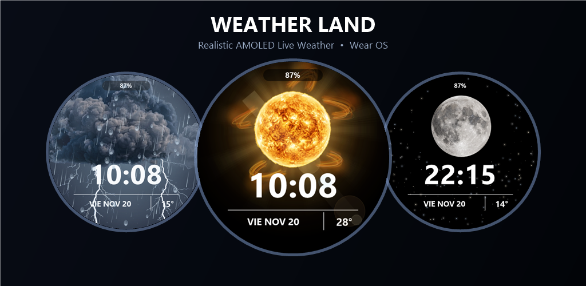

# Weather Land — Realistic AMOLED Watch Face (Wear OS)

Carátula fotorrealista para **Wear OS 5+** (Galaxy Watch 4, 5, 6, 7, 8 y Ultra) construida con **Watch Face Format v2** (XML declarativo puro, sin código ejecutable) sobre fondo negro puro `#000000` AMOLED.

- **Vista previa interactiva (GitHub Pages):** `https://soycamiloypunto.github.io/watchface_weater/`
- **Política de Privacidad (para Google Play Console):** `https://soycamiloypunto.github.io/watchface_weater/privacy.html`



---

## Arquitectura técnica

| Parámetro | Valor |
|---|---|
| **Application ID** | `com.soycamiloypunto.weatherland` |
| **Formato** | Watch Face Format v2 (`com.google.wear.watchface.format.version = 2`) |
| **SDK** | `minSdk = 34` (Wear OS 5), `compileSdk = 36`, `targetSdk = 36` |
| **Resolución base** | `450 × 450` circular (`clipShape="CIRCLE"`) |
| **Código ejecutable** | Ninguno (`android:hasCode="false"`, recurso puro) |
| **Distribución** | Standalone Wear OS (`wearable.standalone = true`) |
| **Fuente de clima** | Nativa Wear OS `[WEATHER.CONDITION]`, `[WEATHER.TEMPERATURE]`, `[WEATHER.IS_DAY]`, `[WEATHER.IS_AVAILABLE]` |

### Orden de capas (Z-Order) en `app/src/main/res/raw/watchface.xml`
1. **Fondo `#000000` AMOLED**: píxeles apagados para contraste máximo y ahorro energético.
2. **Astros**:
   - **Día**: `sol.png` + corona volumétrica giratoria (`fx_sun_corona.png`) + doble capa de llamaradas/ríos de plasma solar (`fx_sun_flares.png`).
   - **Noche**: cálculo astronómico de fase lunar real (ciclo sinódico `29.530588` días) alternando `moon_waxing.png`, `moon_full.png` y `moon_waning.png` + cielo estrellado (`celestial_stars_a/b.png`) con máscara de exclusión sobre el disco lunar.
3. **Tormenta eléctrica**: flash ambiental (`fx_storm_flash.png`) + 3 relámpagos alternados (`lightning_left`, `lightning_center`, `lightning_double`) con animación *slide-down* siempre debajo de la cobertura continua de nubes oscuras.
4. **Nubes volumétricas**: múltiples capas escalonadas moviéndose de izquierda a derecha según el estado (`Seminublado`, `Muy Nublado`, `Lluvia`, `Tormenta`).
5. **Nieve lejana / Niebla descendente / Viento**: capas seamless `450×900` sin saltos.
6. **HUD configurable** (`UserConfigurations`):
   - `show_battery` (Batería `%`)
   - `show_time` (Hora digital `SYNC_TO_DEVICE`)
   - `show_date` (Fecha completa `[DAY_OF_WEEK_S] [MONTH_S] [DAY_Z]`)
   - `show_temperature` (Temperatura redondeada en °)
   - `show_glass_fog` (Activa/desactiva la condensación sobre el cristal)
7. **Efectos sobre el cristal (encima de la hora)**:
   - Lluvia en 2 planos (`fx_rain_slow`, `fx_rain_fast`) + gotas resbalando (`fx_glass_drops_slide`) + vidrio empañado respirando (`fx_glass_fog`).
   - Nieve cercana (`fx_snow_fast`) cayendo suavemente.
   - Niebla baja rápida (`fx_fog_low_fast`, `fx_fog_low_fast_b`) cruzando la parte inferior.
   - Destello solar en el cristal (`fx_sun_glass_flare`).
8. **Modo Always-On Display (AOD / Ambient)**:
   - Apaga por completo los grupos `weather_background` y `watch_crystal_fx` (`alpha = 0`), dejando únicamente la hora y datos esenciales atenuados para cumplir con el presupuesto de memoria (<10 MB) y consumo OLED de Google Play.

---

## Estructura del proyecto

```text
weather_land/
├── index.html                  # Landing + simulador interactivo + Privacidad (GitHub Pages)
├── privacy.html                # Política de Privacidad dedicada (URL para Google Play)
├── preview.html                # Simulador local rápido
├── playstore_assets/           # Capturas 512x512, ícono 512x512 y banner 1024x500
├── docs/images/                # PNGs originales de alta resolución (2048x2048)
├── app/
│   ├── build.gradle.kts        # Configuración Gradle + firma release desde keystore.properties
│   └── src/main/
│       ├── AndroidManifest.xml # Declaración WFF v2 standalone
│       └── res/
│           ├── raw/watchface.xml
│           ├── xml/watch_face_info.xml
│           ├── values/ & values-es/
│           └── drawable/       # Recursos optimizados (450px / 900px) + preview.png
└── gradlew.bat / gradlew       # Gradle Wrapper 8.9
```

---

## Cómo compilar el `.aab` firmado para Google Play

1. Crea `keystore.properties` en la raíz del proyecto (este archivo está en `.gitignore` y **nunca** debe subirse a GitHub):
   ```properties
   storeFile=keystore/weather_land_release.jks
   storePassword=TU_PASSWORD
   keyAlias=weather_land_key
   keyPassword=TU_PASSWORD
   ```
2. Ejecuta:
   ```powershell
   .\gradlew.bat bundleRelease
   ```
3. El paquete firmado listo para subir a Google Play Console se genera en:
   ```text
   app/build/outputs/bundle/release/app-release.aab
   ```

## Activar GitHub Pages para la URL de Privacidad
1. En GitHub abre tu repositorio → **Settings → Pages**.
2. En **Build and deployment**, selecciona **Source: Deploy from a branch**, rama **`main`** y carpeta **`/ (root)`**, luego haz clic en **Save**.
3. En ~1 minuto tendrás activas:
   - Vista previa: `https://soycamiloypunto.github.io/watchface_weater/`
   - Privacy Policy (pegar en Google Play Console): `https://soycamiloypunto.github.io/watchface_weater/privacy.html`
